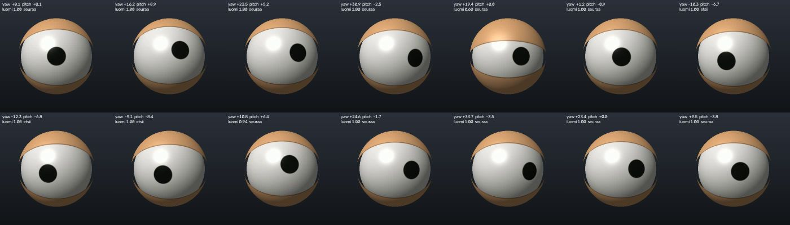
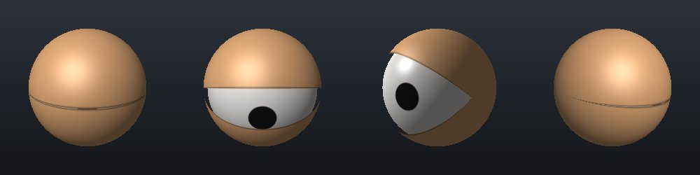

# hahmon-tunnistava-silma

Hahmon tunnistukseen perustuvan 3D-tulostettavan lelun valmistaminen: pallon
muotoinen silmämuna, jonka musta pupilli seuraa silmän yläpuolella olevan
kameran avulla ihmisen kasvoja, ja luomet räpsähtelevät luonnollisesti.



## Pika-aloitus

```sh
python3 -m venv .venv && . .venv/bin/activate
pip install -r requirements-dev.txt

python -m silma --demo      # synteettinen kohde, ei kameraa
python -m silma             # web-kamera 0
python -m silma --video tiedosto.mp4 --headless --record tulos.mp4
pytest
```

Simulaattori-ikkunassa: `a/d/w/s` kiertää katselukulmaa, `r` palauttaa,
`b` räpäyttää, `q` lopettaa.

## Rakenne

| Moduuli | Tehtävä |
|---|---|
| `silma/face_tracker.py` | Kasvojen tunnistus (YuNet), seurattavan henkilön valinta, kuvapiste → 3D-piste → silmän kulmat |
| `silma/behavior.py` | Käyttäytyminen: sakkadit, hidas seuranta, mikrosakkadit, ympärille vilkuilu, räpäytykset |
| `silma/renderer.py` | 3D-simulaattori (numpy-säteenseuranta, ei GPU-riippuvuuksia) |
| `silma/servos.py` | Tila → servokulmat (PCA9685), **ei vielä testattu raudalla** |
| `silma/config.py` | Kaikki säädettävät parametrit ja koordinaatisto |

Ohjainlogiikka (`behavior.py`) tuottaa saman `EyeState`-tilan sekä
simulaattorille että servoille, joten simulaattorissa viritetty
käyttäytyminen siirtyy sellaisenaan lelulle.

### Kasvojentunnistus

Valittu **OpenCV:n YuNet** (`mallit/`, ks. [mallit/README.md](mallit/README.md)):

- ainoa riippuvuus on OpenCV; malli on 230 kt ja toimii Raspberry Pi:llä
- antaa silmien sijainnit, joten silmä katsoo henkilöä *silmiin* eikä
  kasvolaatikon keskelle, ja silmien välistä arvioidaan etäisyys
- vaihtoehto MediaPipe (tarkemmat maamerkit, raskaampi, ARM-tuki vaihtelee)
  – ei tarvita tähän tehtävään

Koska kamera on silmän yläpuolella, lähellä oleva henkilö näkyy kamerasta eri
kulmassa kuin silmästä. `face_to_target` korjaa tämän parallaksin
etäisyysarvion avulla (`CameraConfig.offset_m`).

### Käyttäytyminen

- **Sakkadit**: yli 3° kohteen siirto tehdään nopeana hyppynä
  (kesto ≈ 20 ms + 2,5 ms/aste, minimum-jerk-profiili), pienet siirrot
  seurataan hitaasti.
- **Räpäytykset**: välit log-normaalijakaumasta (~17/min), välillä
  tuplaräpäytys; suuri katseen siirto laukaisee usein räpäytyksen.
  Sulkeutuminen 75 ms, auki 160 ms.
- Yläluomi seuraa katseen pystysuuntaa.
- Kun kasvot katoavat, silmä katsoo hetken viimeiseen kohtaan ja alkaa
  sitten vilkuilla ympärille.

## 3D-mallin työkalut

Tarpeita on kaksi erilaista, ja niihin kannattaa käyttää eri työkaluja:

1. **Testisimulaattori (tehty)** – `silma/renderer.py`. Koska kaikki pinnat
   ovat palloja, kuva lasketaan suoraan numpylla. Ei asennettavaa, toimii
   myös ilman näyttöä (videotallenne). Malli vastaa mekanismia: silmämuna
   kahdella akselilla + kaksi pallonkuorimaista luomea vaaka-akselilla.
2. **Tulostettavat osat (seuraava vaihe)** – parametrinen CAD:
   - *OpenSCAD* tai *CadQuery* (Python): koodina, versionhallittava, samat
     mitat kuin `config.py`:ssä → suositus
   - *FreeCAD* / *Fusion 360*: graafinen, hyvä mekanismin
     kokoonpanoon ja servojen vipuvarsiin
   - *Blender* vain, jos halutaan fotorealistinen esitys; ohjaukseen ja
     tulostukseen tarpeeton


